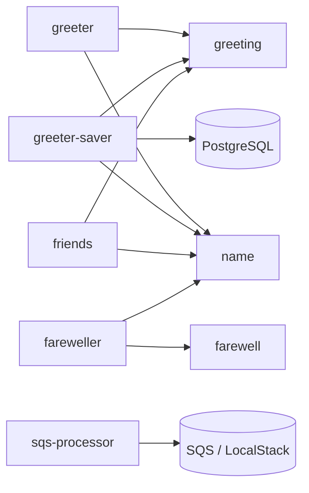

# Applications

[](https://github.com/juanroldan1989/applications/actions/workflows/ci.yml)


_A set of small Flask microservices used as a realistic workload for practising container delivery: Docker Compose, health checks, service-to-service calls, a database and CI._

## Table of Contents

1. [Overview](#overview)
2. [Quickstart](#quickstart)
3. [Services](#services)
4. [Development](#development)
5. [CI](#ci)
6. [Publishing images](#publishing-images)
7. [Contributing](#contributing)
8. [License](#license)

# Overview

Each service is small on purpose, so the interesting part is how they run together: dependent startup order, health checks, configuration through environment variables, a PostgreSQL-backed service and an SQS consumer tested against LocalStack.

Every service has its own `Dockerfile` (multi-stage, non-root, Python 3.12), unit tests and README. Images are published for `linux/amd64` and `linux/arm64`.



# Quickstart

Requires Docker with Compose.

```bash
docker compose up --build -d

curl localhost:5006/greet     # greeter        -> {"message":"Hello, Alice!"}
curl localhost:5003/          # fareweller     -> {"message":"Ciao, Bob!"}
curl localhost:5008/greet     # greeter-saver  -> same, and stored in PostgreSQL
```

Open http://localhost:5007 for the Friends UI.


Stop and clean up with `docker compose down -v`.

> The credentials in `docker-compose.yaml` (`user` / `password`, LocalStack `test`) are for local use only.

# Services

| Service | Host port | Endpoints | Depends on | Description |
|---|---|---|---|---|
| [name](/services/name/README.md) | 5001 | `/name`, `/health` | - | Returns a random name. |
| [greeting](/services/greeting/README.md) | 5002 | `/greeting`, `/health` | - | Returns a random greeting phrase. |
| [farewell](/services/farewell/README.md) | 5004 | `/phrase`, `/health` | - | Returns a random farewell phrase. |
| [greeter](/services/greeter/README.md) | 5006 | `/greet`, `/health` | name, greeting | Combines a greeting and a name. |
| [fareweller](/services/fareweller/README.md) | 5003 | `/`, `/health` | name, farewell | Combines a farewell and a name. |
| [greeter-saver](/services/greeter-saver/README.md) | 5008 | `/greet`, `/health` | name, greeting, PostgreSQL | Same as greeter, and stores each message in the database. |
| [friends](/services/friends/README.md) | 5007 | `/`, `/health` | name, greeting | Web UI showing the greeting in a bubble next to a character from "Friends" (chosen with `FRIEND`). |
| [sqs-processor](/services/sqs-processor/README.md) | 5005 | `/`, `/api/poll-sqs` | SQS (LocalStack locally) | Polls an SQS queue, optionally posts to Slack and shows stats on a landing page. |

# Development

Run a service's tests without Docker:

```bash
cd services/greeter
python3.12 -m venv .venv && source .venv/bin/activate
pip install -r requirements.txt
python -m unittest
```

The tests mock every external dependency, so they need no running services or database.

# CI

[`.github/workflows/ci.yml`](.github/workflows/ci.yml) runs one matrix job per service:

1. **Test**: installs the service's pinned dependencies and runs its unit tests on Python 3.12.
2. **Build** (pull requests): builds the image once its tests pass, without publishing.
3. **Publish** (pushes to `main`): builds `linux/amd64` and `linux/arm64` images and pushes them to Docker Hub.

Images are tagged with the short commit SHA (`juanroldan1989/<service>:<sha>`). Publishing uses the `DOCKER_USERNAME` and `DOCKER_PASSWORD` (a Docker Hub access token) secrets of the `dockerhub` environment, which only the `main` branch can use.

# Publishing images

To publish all images by hand with a tag of your choice (defaults to `latest`), run from the `scripts` folder:

```bash
cd scripts
./build-and-push-images.sh 0.0.1
```

The script also builds one `friends` image per character (`chandler`, `joey`, `monica`, `phoebe`, `rachel`, `ross`), tagged with the character name.

To remove every local image, container and volume Docker knows about, run `scripts/docker-clean-up.sh`. It is destructive and not limited to this project.

# Contributing

Contributions are welcome and greatly appreciated! If you would like to contribute to this project, please follow the guidelines within [CONTRIBUTING.md](CONTRIBUTING.md).

# License

This project is licensed under the terms of the [MIT License](LICENSE).
